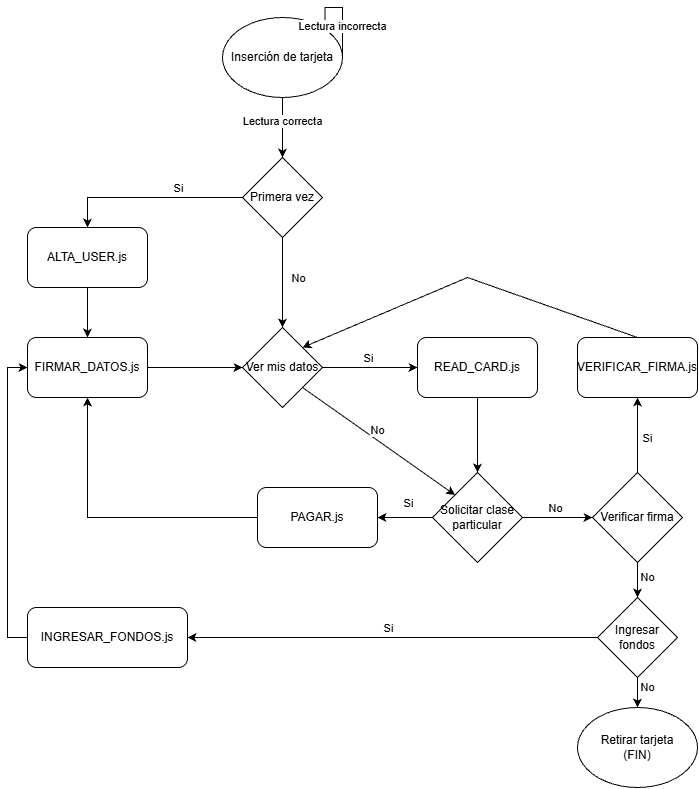

# Explicación del servicio: Sistema de clases particulares virtual

Nuestro servicio para esta práctica de tarjetas de contacto consiste en un sistema de de reserva de clases particulares usando la tarjeta para hacer el pago de las mismas.

Los usuarios dados de alta tendrán la capacidad de elegir entre los profesores disponibles junto con las asignaturas que cada uno imparte para pagar una clase particular, especificando el número de horas a reservar.

El sistema tiene además como funcionalidad extra la de acumular un percentaje cada pago realizado como descuento acumulable que se puede aplicar en futuras transacciones, pudiendo llegar a conseguir un pago gartuíto de la clase si se acumula el importte suficiente.

# Diagrama de funcionamiento

A continuación se muestra un diagrama de la relación entre las ditintas funcionalidades del servicio y la forma en la que funcionaría el sistema:

# Funcionalidades implementadas en los scripts

**READ_CARD.js**

Clase con la que, al ejecutar, permite al usuario ver la información relevante de su cuenta. Concretamente se muestran los siguientes campos:
- **Nombre**: Nombre con el que se dió de alta el usuario. Los apellidos está en otros campos pero para la bienvenida solo se muestra el nombre
- **Saldo**: Los fondos actuales que tiene el usuario en su cuenta. Es uno de los campos que se usarán al realizar los pagos e ingresos. Se ha decidido representarlo en dólares ($).
- **Descuento**: El valor (también representado en dólares) del descuento acumulado por el usuario tras realizar pagos. Se ha decidido que este valor no pueda superar los 99.99$ y que con cada compra, se acumula un descuento del 5% de lo que ha costado.

**ALTA_USER.JS**

Claso cuyo propósito es dar de alta a un usuario usando la información de cuenta que este proporcione. Se deben rellenar los siguientes campos:
- **Nombre del usuario**
- **Primer apellido del usuario**
- **Segundo apellido del usuario** *(Si tuviese)
- **Fecha de creación de cuenta** *(Lo rellena el sistema con la fecha actual en la que la cuenta se crea)
- **Saldo** *(Los nuevo usuarios obtienen un bono de bienvenida de 50$)
- **Descuento** *(Empieza a 0, el usuario irá acumulando con cada compra)
- **Firma** *(Tras dar de alta a un usuario, se debe firmar su información ejecutando el script para firmar, si no, la verificación de firma dará que los datos se han modificado ilegalmente)

**FIRMAR_DATOS.js**

Tras modifiacr los datos del usuario de cualquier forma legítima (dar de alta, pagar una clase o ingresar fondos al monedero), se debe ejecutar este script para firmar la información actualizada y demostrar que los datos son legítimos.

Para la firma, se ha decidido que se conforme del HASH de los datos usando SHA256 y posteriormente cifrarlo usando AES-CBC.

**VERIFICAR_FIRMA.js**

Script utilizado para comprobar la legitimidad de los datos de la tarjeta. Se descifra la firma de la tarjeta y se calcula el HASH de la informacón actual usando los mismo algoritmos. Si ambos son iguales, la información es legítima, si no, se han modificado ilegalmente.

**PAGAR.js**

La funcionalidad principal de nuestro servicio. El cliente puede contratar una a un profesor de los registrados en la aplicación para que le de una clase de una asignatura que elija (simpre y cuando la imparta ese profesor).

El cliente también tiene la elección de aplicar el descuenta que lleva acumulado a la compra, pudiendo, si ha acumulado lo suficiente, hacer que esta sea gratuíta.

La transacción se abortará en los siguientes casos:
- *El profesor o la asignatura especificada por el cliente no existe*
- *La asignatura especificada por el clente para que le de el profesor no es una de las que oferta*
- *El cliente no puede pagar la clase*

Al realizarse correctamente la transacción, la aplicación mostrará por pantalla un ticket con la información de compra y actualización de campos.

**INGRESAR_FONDOS.js**

El cliente tiene la posibilidad de ingresar una cantida que especifique al saldo de su monedero.

**db.js**

Esta clase funciona como ***clase de datos***. En ella se guardan todos los profesores que usa la aplicación, las asignaturas, la relación entre los profesores y asignaturas y el precio que cada profesor oferta por una clase.
